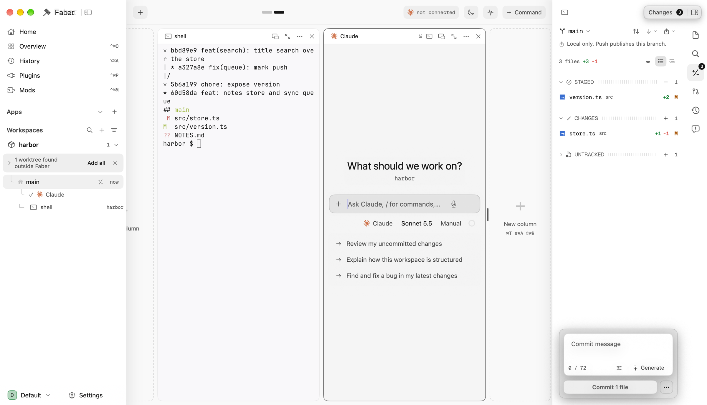
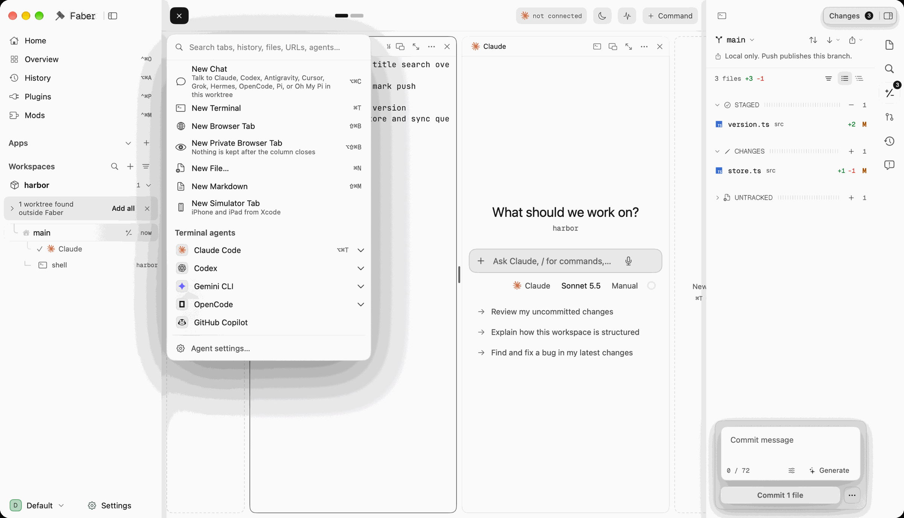
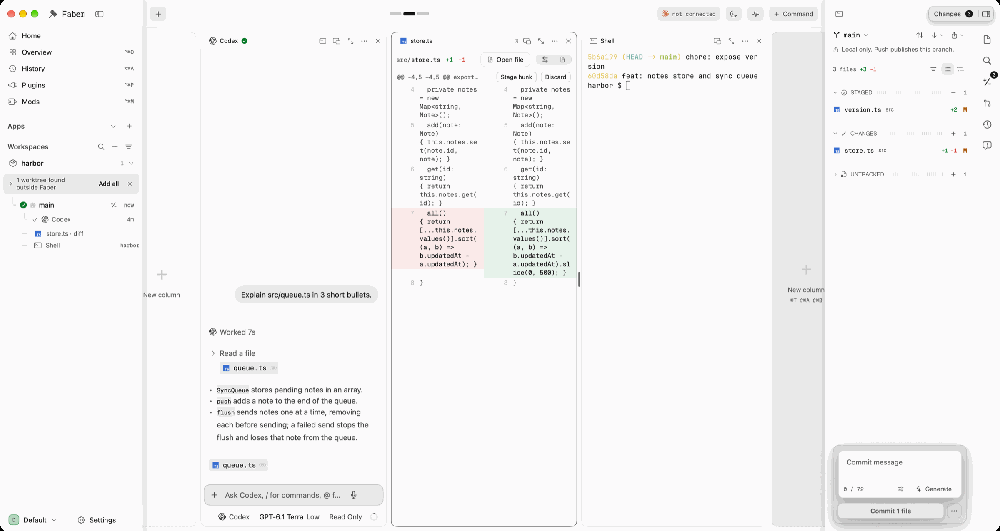
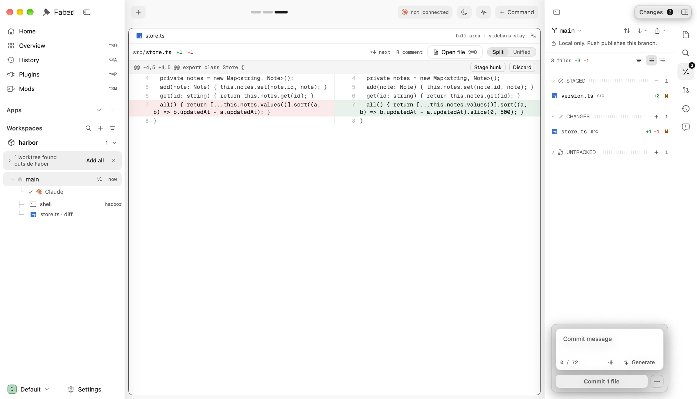
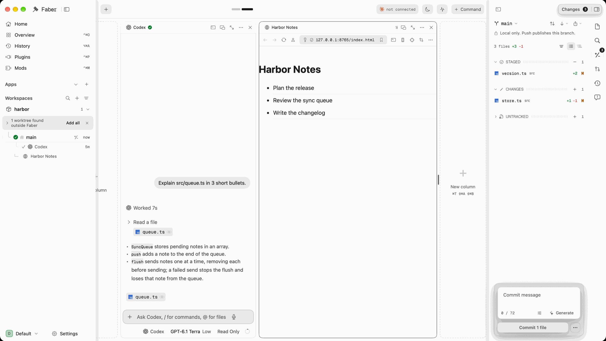
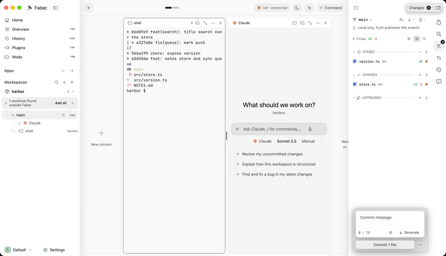
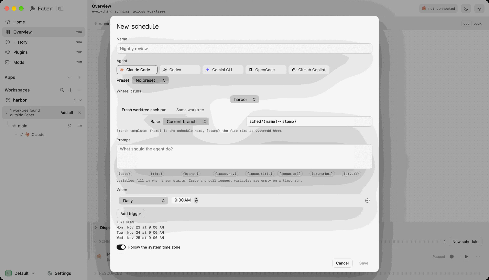
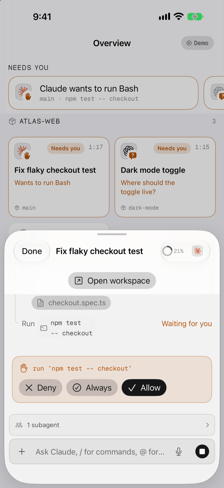

<div align="center">


# Faber

### The agentic development environment for macOS

Run Claude Code, Codex, Gemini CLI and 20 other coding agents side by side.
Each task gets its own git worktree, with review, browser and phone control in the same window.

[](https://github.com/katipally/faber-ADE/releases/latest)
[](https://github.com/katipally/faber-ADE/releases)
[](https://katipally.github.io/faber-ADE/install-and-update.html)
[](https://katipally.github.io/faber-ADE/install-and-update.html)
[](https://katipally.github.io/faber-ADE/)
[](LICENSE)
[](mods/LICENSE)
[](https://katipally.github.io/faber-ADE/)

[](https://github.com/katipally/faber-ADE/releases/latest/download/Faber.dmg)
&nbsp;
[](https://katipally.github.io/faber-ADE/)
&nbsp;
[](https://apps.apple.com/app/id6832401836)
&nbsp;
[](mods/README.md)

</div>

<p align="center">
  <picture>
    <source media="(prefers-color-scheme: dark)" srcset="docs/assets/screens/hero-1-dark.png" />
    
  </picture>
</p>

---

## Why Faber

Coding agents are great, but a pile of terminal tabs is not a workflow. Faber is a native Mac workbench that gives every task its own worktree and lets you watch, review and steer many agents at once, from your Mac or your phone.

```
workspace
  worktree           one per task
    strip of columns
      column         a tiled grid of panes
        pane         terminal | chat | browser | files | diff | simulator
```

## Features

| | |
|---|---|
| **Terminal agents and native chat**<br>Claude Code, Codex, Gemini CLI, OpenCode, Copilot, Cursor CLI, Amp, Goose, Aider and more, or add your own command. [Learn more](https://katipally.github.io/faber-ADE/features/terminals-and-agents.html) |  |
| **Workspaces and worktrees**<br>One worktree per task, each a strip of columns you tile with terminals, chats, files, diffs and web pages. [Learn more](https://katipally.github.io/faber-ADE/features/workspaces-and-layouts.html) |  |
| **Git and PR review**<br>Inline notes for agents, a conflict resolver, stacked PRs, commit, push, pull and discard. [Learn more](https://katipally.github.io/faber-ADE/features/git-and-prs.html) |  |
| **Built-in browser, Apps and iOS Simulator**<br>Preview what an agent builds without leaving the window. [Learn more](https://katipally.github.io/faber-ADE/features/browser.html) |  |
| **Floating windows (PiP)**<br>Float any tab into an always-on-top window and dock it back with Option F. [Learn more](https://katipally.github.io/faber-ADE/features/pip.html) |  |
| **Scheduled agents**<br>Run agents on a timer or on an event. [Learn more](https://katipally.github.io/faber-ADE/features/scheduled-agents.html) |  |

Also: libghostty terminals that keep running through app updates, files and markdown, history, usage and Home, a CLI and control API, keep awake, and themes. See the [full feature list](https://katipally.github.io/faber-ADE/).

## Install

Requirements: macOS 26 or later on Apple silicon. Bring your own agents; Faber launches the CLIs you already have installed.

1. [Download Faber.dmg](https://github.com/katipally/faber-ADE/releases/latest/download/Faber.dmg).
2. Open it and drag Faber to Applications.
3. Open Faber. Releases are signed with a Developer ID and notarized by Apple, so Gatekeeper opens them without a warning.

The first launch walks you through your agents, status hooks and optional iPhone pairing. Faber updates itself with Sparkle. All releases are on the [Releases page](https://github.com/katipally/faber-ADE/releases). Details: [install and update](https://katipally.github.io/faber-ADE/install-and-update.html).

## iPhone companion

**Faber Companion** is the remote for your Mac's Faber: chat, approvals, diffs, terminal, files, a widget and Shortcuts. Connections are end-to-end encrypted. Needs iOS 27 or later and an iCloud account.

[](https://apps.apple.com/app/id6832401836)

<p align="center">
  
</p>

Guides: [overview](https://katipally.github.io/faber-ADE/phone/overview.html), [pairing](https://katipally.github.io/faber-ADE/phone/pairing.html), [features](https://katipally.github.io/faber-ADE/phone/features.html).

## Mods

Mods are small JS add-ons that gate tool calls, rewrite prompts, add context and put UI in chats. Community mods live in [`mods/`](mods/README.md) and are MIT licensed.

```
faber mod marketplace add katipally/faber-ADE
faber mod search weather
faber mod install <id>@faber-ADE
```

Faber shows a consent card with every capability a mod needs. Read [installing](https://katipally.github.io/faber-ADE/mods/installing.html) and [writing a mod](https://katipally.github.io/faber-ADE/mods/writing-a-mod.html), then share yours via [publishing](https://katipally.github.io/faber-ADE/mods/publishing-and-marketplace.html).

## Docs and help

- [Documentation](https://katipally.github.io/faber-ADE/)
- [FAQ](https://katipally.github.io/faber-ADE/faq.html) and [troubleshooting](https://katipally.github.io/faber-ADE/troubleshooting.html)
- Bugs and ideas: [open an issue](https://github.com/katipally/faber-ADE/issues/new/choose)
- Pairing and alerts: [SUPPORT.md](SUPPORT.md)
- [Changelog](CHANGELOG.md)

## Privacy

Your agents run on your Mac with your own accounts. Faber sends only anonymous usage counts, never your chats, code, files or terminals. On the Mac analytics are on by default and one switch turns them off (Settings, Privacy & Sync). On iPhone they are opt-in. Read [PRIVACY.md](PRIVACY.md) and [privacy and telemetry](https://katipally.github.io/faber-ADE/features/privacy-and-telemetry.html).

## Security

Releases are signed and notarized, and updates are signature checked. Report vulnerabilities privately as described in [SECURITY.md](SECURITY.md).

## License

Faber is free to use, personal or commercial. The app is proprietary and its source is not public; this repo hosts releases, the update feed, issues, mods, the license and the privacy policy. Community mods are MIT licensed. See [LICENSE](LICENSE), [mods/LICENSE](mods/LICENSE) and [third-party notices](THIRD_PARTY_NOTICES.md).

<div align="center">

Copyright 2026 Yashwanth Reddy Katipally

</div>
