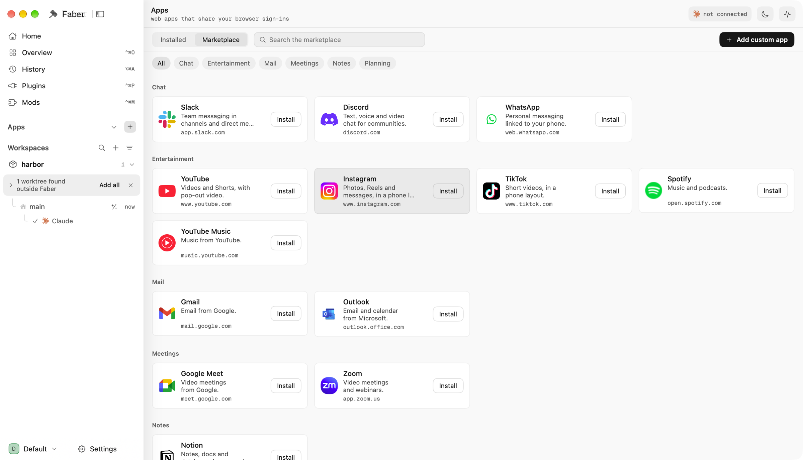

Apps are web pages kept signed in and shown as columns. They appear as sidebar tiles, on the Apps page, and in a marketplace of common services such as Gmail, Slack, Notion and Linear. You can add your own.

## Accounts

- Shared (default): uses the browser's profile, so one sign-in covers the app and every column.
- Isolated: the app gets its own cookies, logins and permissions, for a second account. Add another account makes an isolated copy.

## Sleep

Apps sleep when out of view and quiet for 30 minutes (sooner under memory pressure) and keep their last address. A sleeping app cannot notify. The tile dot shows loading, ready, signed out, failed or sleeping.

## Per app settings

Home page, how links to other sites open, zoom, web appearance, data mode, user agent, camera, microphone and location, add account, remove. Removing an isolated app deletes its cookies and site data; a shared app's sign-in stays with the browser.

Compatibility is checked per service and not every flow is verified. Sign-in detection for custom apps is a heuristic.
