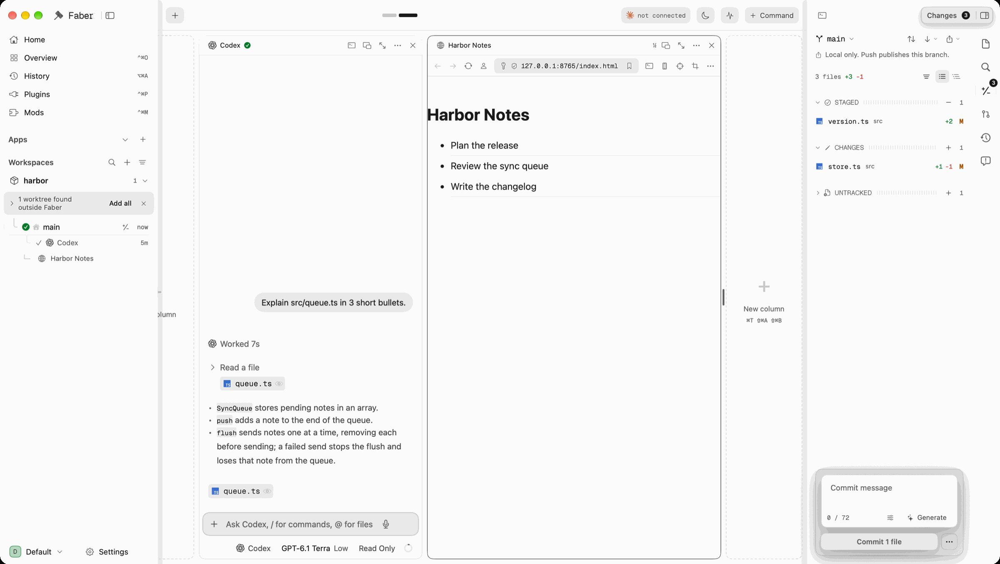

Browser columns share one signed-in profile across worktrees. Named profiles keep their own logins, and private columns keep nothing.

## Keys

| Action | Key |
|---|---|
| Address bar, new page, reopen closed page | Cmd L, Cmd T, Shift Cmd T |
| Back, forward, reload | Cmd [, Cmd ], Cmd R |
| Bookmark, show bookmarks | Ctrl Cmd B, Opt Cmd B |
| History (not in private columns) | Cmd Y |
| Fill saved login | Shift Cmd L |
| Reader mode | Opt Cmd R |

## What is built in

- Security indicator with certificate details, site permissions, bookmarks, downloads and extension buttons in the address bar.
- Page menu: zoom, find, annotate, pause trackers, clear site data, open in default browser, sign in with another browser.
- Passwords live in the macOS keychain and are never offered for saving in private columns.
- Web extensions from the Chrome Web Store, a folder, a zip or crx, or a Safari extension, running on WebKit's extension engine. There is no native messaging.
- Faber can be the default browser; links from other apps open in a column of the current worktree.

## Settings

Settings, Browser covers the default browser, link routing rules, tracker blocking, HTTPS upgrade, Global Privacy Control, passwords, clear browsing data, the download folder and extensions.

## Agent control

With the permission granted, agents can snapshot, click, fill, screenshot and read the console of browser columns through the [control API](cli-and-control-api.html).
