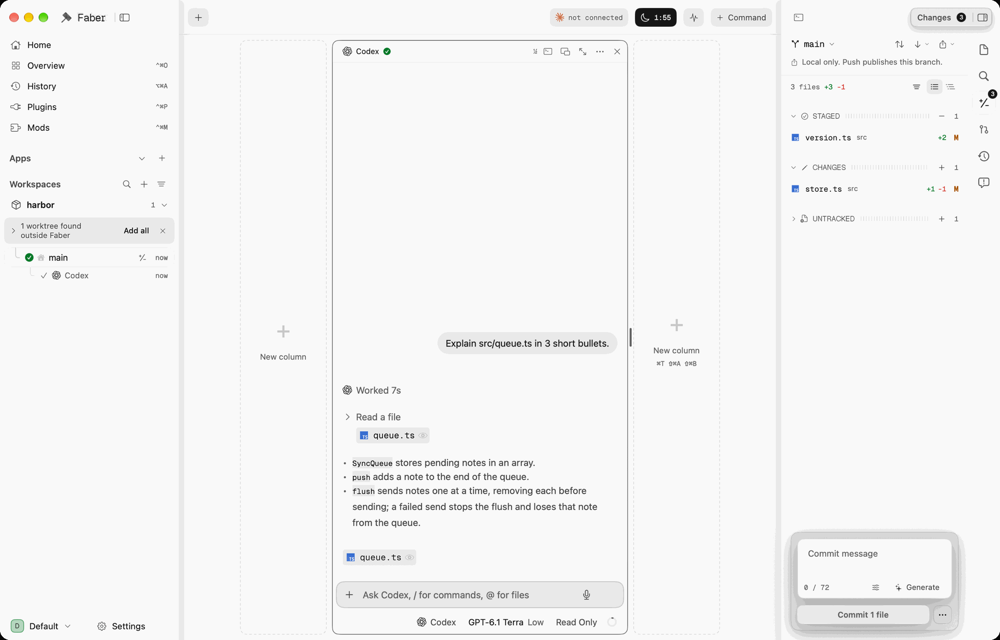

A chat column talks to an agent without a terminal, and the same features apply to every agent that supports them.

## Composer

The send button morphs between Send, Queue (Return while the agent works), Steer (hold Command while it works) and Stop. A pill over the transcript counts what arrived while you were scrolled up and jumps to the end.

## Turns and files

- Retry and Regenerate on the newest turn rewind the conversation and files, then send the same message again. Edit turn recalls the message and attachments and rewinds only when you send.
- After a turn that changed files, a Keep or Undo card lists them. Undo restores the files and keeps later changes.
- The receipt line shows tokens and cost for agents that report them (Claude, OpenCode).
- Long chats open on the latest turns; Load earlier pages older ones in.

## Display

Tall code blocks scroll with an Expand button. Mermaid fences draw as diagrams once the fence closes. With Reduce Motion on in macOS, replies appear without the fade.

## MCP and limits

- `/mcp` turns MCP servers off for this chat (Claude and Codex).
- Keep agents ready (Settings, Agents, Chat) keeps one idle Claude process for your next new chat in the current worktree. It pauses in Low Power Mode, under heat or memory pressure.
- When Claude or Codex hits a usage limit, the failed turn offers Continue on another account when another login has headroom.
- Usage warnings fire at 80 percent by default (or off) and always at 95 percent. See [usage and Home](usage-and-home.html).

## Dictation

Dictation turns speech into text on the device with Apple's speech analyzer. Audio is not sent anywhere. The first use may download Apple's language model.
