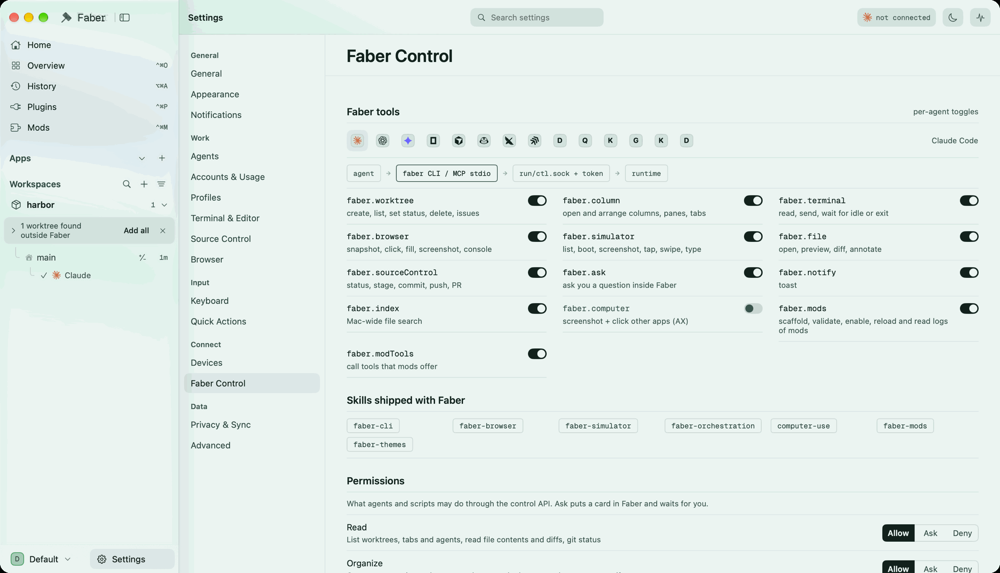

Faber links `~/.faber/bin/faber` on launch. The CLI talks to the running app over a local Unix socket, and starts Faber if it is not running.

```
faber app status
faber workspace add ~/code/repo
faber .
faber worktree create fix-login --agent claude --prompt "Fix the redirect bug" --background
faber worktree create --pr 123
faber tab open terminal --worktree fix-login
faber terminal send "swift test" --enter --tab <id>
faber terminal wait --tab <id> --for text --text "passed"
faber pr comments
faber mcp
```

Run `faber <group> <command> --help` for details.

## Command families

`worktree`, `workspace`, `issue`, `column`, `pane`, `tab`, `terminal`, `agent`, `schedule`, `dispatch`, `browser`, `simulator`, `file`, `git`, `pr`, `ask`, `notify`, `index`, `computer`, `mod`, `theme`, `app`, `events`. Also `faber prompt link`, `faber skills` and `faber doctor`.

## MCP

`faber mcp` runs an MCP stdio server exposing the same verbs as tools. Settings, Faber Control registers it for each agent and can switch tool groups off per agent (worktree, column, terminal, browser, simulator, file, source control, ask, notify, index, computer, mods, mod tools). Computer use is off by default.

## Permissions

Every call is gated by a capability set to allow, ask or deny in Settings, Faber Control.

| Capability | Default |
|---|---|
| Read, Organize, Author mods, Set themes, Run mod tools | Allow |
| Customize Faber, Write files, Drive browser, Drive Simulator, Control terminals, Git commit | Ask |
| Computer use | Deny |



## Links

`faber://open?path=...` opens a path and never runs anything. `faber://prompt?...` opens a review sheet and never runs without your Run click.
