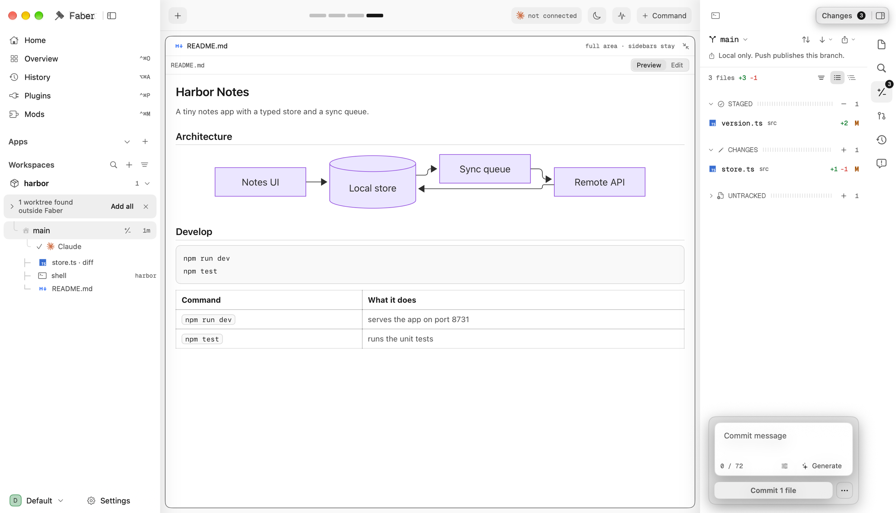

Faber opens files in the pane that fits them.



## Viewers

Code (syntax highlighted, with blame), markdown (with Mermaid diagrams), JSON and plist trees, CSV and other delimited tables, images with compare, SVG, HTML, logs, PDF, video, audio, Quick Look types, fonts, notebooks, archives, SQLite databases and patches. Unknown binaries open as bytes.

## Search

Find in Files searches the selected worktree. A Mac-wide file search is also available to agents through `faber index find`.

## Open from the shell

```
faber .                      # this folder
faber src/main.swift:42:7    # a file at line 42, column 7
faber open notes.md --new-window
```

A file opens in the editor tab of the worktree that contains it. Finder lists Faber under Open With for folders, text, source, JSON, XML, Markdown and shell files.

## Review notes

Diffs and files accept inline notes that can be sent to an agent.
