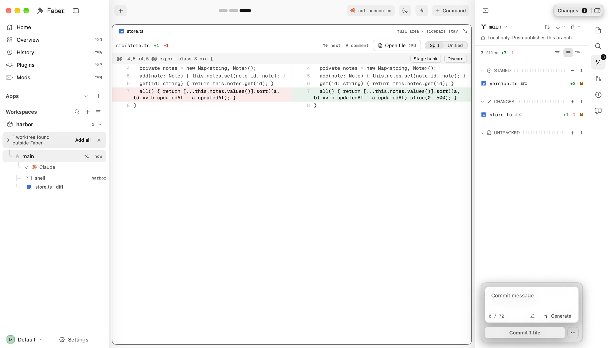
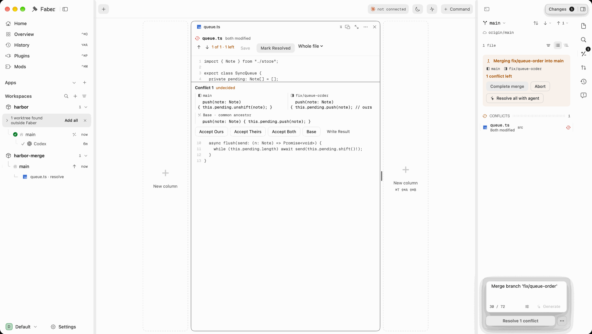

The right inspector has a rail of tabs: Files, Search, Changes, Pull Requests, History and Issues.

## Changes

Branch row (switch, create, rename, delete with Undo), Fetch, Pull (fast-forward or rebase) and Push (force push with lease asks first), conflicts, staged and untracked changes, line and hunk staging, and a last checkpoint line. A diff can be split or unified, and can ignore whitespace.

## Commit messages

Generate sends the staged diff to the agent chosen in Settings, Source Control, Commit messages, once, and fills the message.

## Conflicts and history

- A conflict resolver for merge conflicts.
- A commit graph with lanes, search and per-commit actions (check out, branch, tag, cherry-pick, revert, reset, compare).
- Interactive rebase with pick, reword, squash, fixup, drop and edit.
- Repository Tools: reflog, submodules, git-lfs, bisect, patches, config, signing.
- Blame in the code editor.

## Pull requests

GitHub works through `gh` and GitLab through `glab`, picked from the git remote. Faber shows checks, review comments and a merge sheet that offers only the methods the repository allows. Merging changes the base branch and cannot be undone, so it asks.

## Stacked pull requests

Stack on This Worktree makes a worktree whose branch starts at the parent's tip, nested in the sidebar with a level chip. Its pull request targets the parent branch. `faber worktree restack --all` rebases the stack bottom first.

## Issues

The Issues tab lists issues from GitHub, GitLab, Linear or Jira, and a new worktree can start from one with the issue as the first prompt.

## Search

Find in Files uses `git grep` with plain text or regular expressions, match case, whole word and include and exclude globs.
