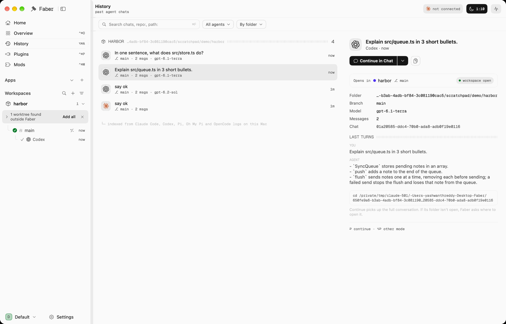

History lists past agent chats read from the logs on this Mac. It indexes Claude Code, Codex, Pi, Oh My Pi and OpenCode.

- Search with Cmd F.
- Each session shows the agent, how long ago it ran, and its last turns.
- Continue picks up the full conversation. If the session's folder is not open, Faber asks where to open it.
- Return continues; Option Return continues in the other mode.

Nothing leaves your Mac: History reads local files and builds its own index.
