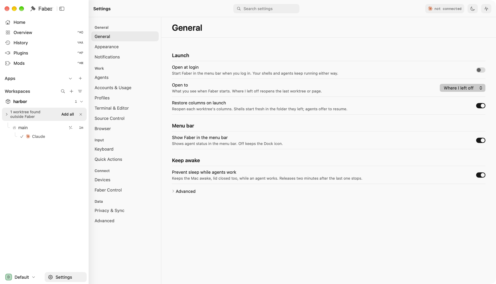

Settings, General, Keep awake: Prevent sleep while agents work.

- Keeps the Mac awake, lid closed too, while an agent works, and releases two minutes after the last one stops.
- Battery floor: on battery, Faber stops keeping the Mac awake below this charge (default 10 percent).
- Stop when the Mac overheats: on by default, stops at a critical thermal state.
- Power helper: lid-closed mode needs a small root helper. Approve it once in System Settings, Login Items, and remove it from the same pane.

The same helper lets [scheduled agents](scheduled-agents.html) wake a sleeping Mac before a run.
