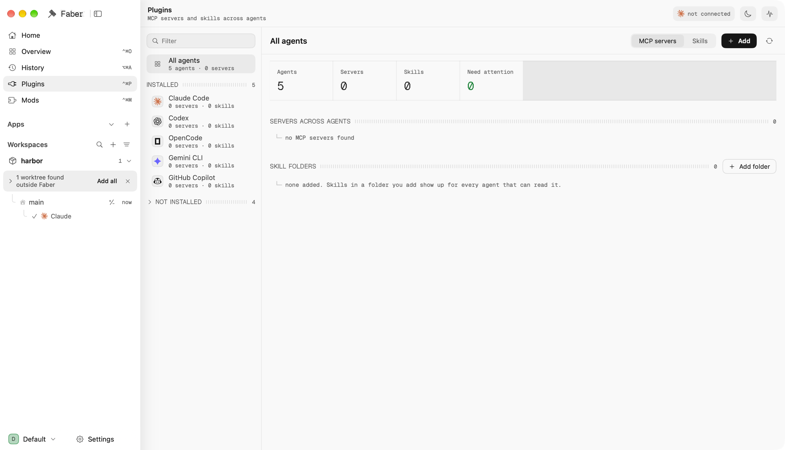

The Plugins page shows the MCP servers, skills and plugins your agents have, in one place, per agent or for all agents. It scans each agent's own config and project files.

- Add an MCP server or a skill for one or several installed agents from the add forms.
- A Needs attention list calls out items that want a look.
- Servers and skills live in the agent's own config, so removing Faber does not remove them.
- In a chat, `/mcp` turns MCP servers off for that chat (Claude and Codex).

## Faber's own server and skills

Settings, Faber Control registers Faber's MCP server (`faber mcp`) and skills for each agent, and links the CLI into your PATH. See [CLI and control API](cli-and-control-api.html). The skills include guides for making [mods](../mods/writing-a-mod.html) and themes.
