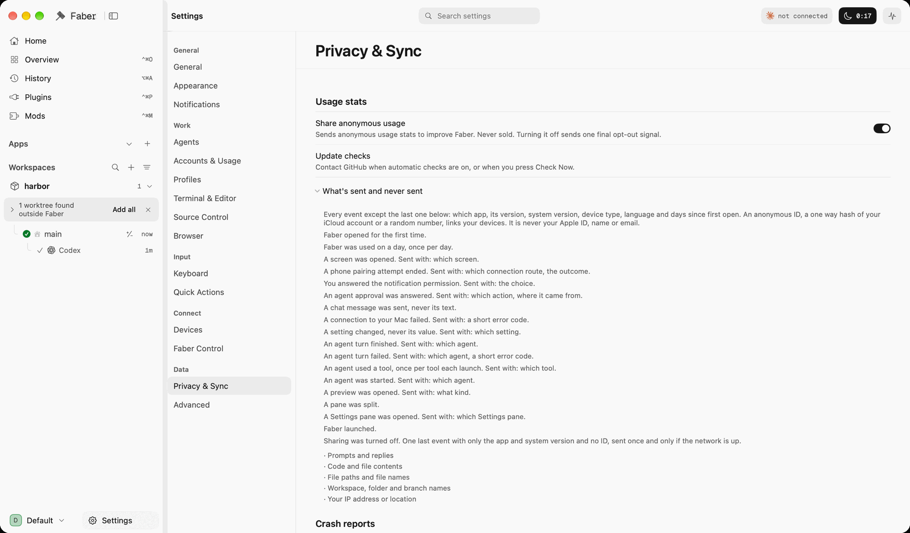

The full policy is [PRIVACY.md](https://github.com/katipally/faber-ADE/blob/main/PRIVACY.md). Short version:

## Where your work stays

Agents run on your own Mac with your own provider accounts. Faber does not proxy their traffic and does not send chat content to Faber servers. The phone only relays between your own devices.

## Mac analytics: on by default

Anonymous usage counts and fixed labels are on by default, with a notice on Home. To turn them off: Settings, Privacy & Sync, switch off Share anonymous usage. That deletes the queue and your anonymous ID. You can also start Faber with `FABER_TELEMETRY=off` or `DO_NOT_TRACK=1`.

## iPhone analytics: opt in

Faber Companion asks once at the end of onboarding and sends nothing unless you say yes. Change it any time in Settings, Privacy.

## Never sent

Prompts, replies, code, file contents, paths and names, branch names, error text, your name or email, your IP address or location.

## Endpoint

A self-hosted OpenPanel at `telemetry.openlive.dev`.

## Crash reports

After a crash, the next launch shows the redacted report. Nothing is sent unless you press Send.

## Dictation

Speech to text is on-device. Audio never leaves the device. The first use may download Apple's language model.

## Updates

Update checks contact GitHub, separately from analytics.
