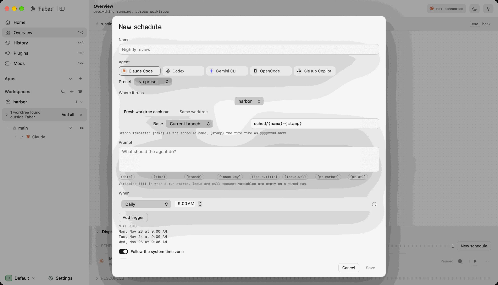

The Schedules section in the footer of the Overview runs an agent by itself, in a fresh worktree or a fixed one, with a prompt.



## A schedule has

An agent (built in or custom, with an optional launch preset), a workspace, a prompt and one or more triggers.

| Trigger | Meaning |
|---|---|
| Every | Every N minutes (at least 5) or hours |
| Daily | At a time |
| Weekly | On chosen weekdays at a time |
| New issue | A new issue matching a filter |
| New pull request | A new PR |
| CI failed | Checks failed on a PR Faber watches |

Event triggers only fire while Faber is running. Faber asks the tracker or `gh` every five minutes, not in Low Power Mode, under serious heat, or offline. Each issue or PR starts a schedule once.

## Runs

- A run starts in the background, in a branch named from the template `sched/{name}-{stamp}` off a base you pick, and never takes focus.
- Prompts can use `{date}`, `{time}`, `{branch}`, `{issue.key}`, `{issue.title}`, `{issue.url}`, `{pr.number}` and `{pr.url}`.
- At most 1 to 5 runs at once per schedule, with notification choices: every finish, failures only, or never.
- Missed fires are caught up at the next launch or wake, within seven days: run once, or skip.

## While Faber is closed

For time triggers Faber writes a per-user LaunchAgent that starts Faber in the background at the next fire. Waking a sleeping Mac needs the power helper (the same one lid-closed mode uses), approved once in System Settings, Login Items. Without it, runs wait for the Mac to be awake.

## CLI

```
faber schedule add nightly --trigger "daily 02:00" --prompt "Review yesterday's commits" --wake
faber schedule list
```

Also `show`, `run`, `pause`, `resume` and `remove`. Adding, running and removing need the Control terminals permission.
