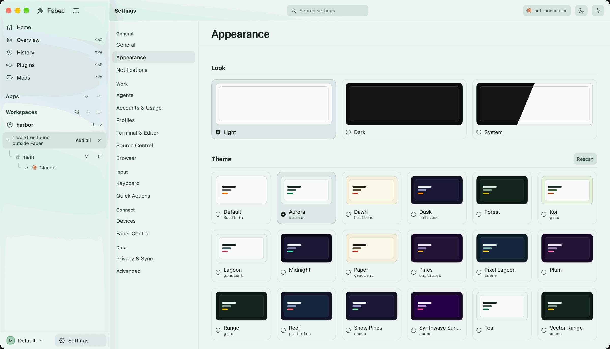

## Panes

| Group | Panes |
|---|---|
| General | General, Appearance, Notifications |
| Work | Agents, Accounts & Usage, Profiles, Terminal & Editor, Source Control, Browser |
| Input | Keyboard, Quick Actions |
| Connect | Devices, Faber Control |
| Data | Privacy & Sync, Advanced |

Settings has a search. Mods have their own page (Ctrl Cmd M).

## Themes

A theme is JSON: color tokens, surface opacity and an optional animated backdrop (gradient, particles, grid, halftone, aurora or a layered scene). 17 themes ship with Faber. Settings, Appearance, Theme picks one everywhere or for the open workspace only.

- `/theme` lists themes, `/theme <name>` applies one and `/theme <name> --project` keeps it for the workspace.
- Your own themes go in `<home>/themes/<id>.json` and shadow a bundled one with the same id.
- Faber guarantees legible text on translucent surfaces. Reduce Transparency and Increase Contrast make surfaces opaque, and Reduce Motion or Low Power Mode freeze backdrops.
- Agents can set themes through `faber theme` with the Set themes permission.

