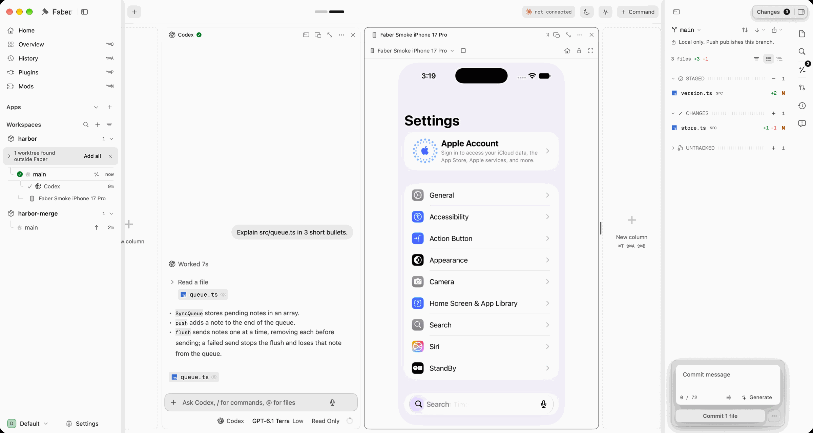

A Simulator tab (New Simulator Tab in the + or File menu, or `faber simulator open`) shows an iPhone or iPad simulator from your Xcode in a column, with mouse, trackpad scroll and keyboard input.

## Needs

Xcode with at least one iOS runtime. No extra macOS permission is asked. Without Xcode the menu entry is disabled and says so.

## Use

- The toolbar picks the device, boots or shuts it down, presses Home and Lock, and copies a screenshot or sends it to an agent.
- Drag is a finger, the trackpad scrolls, and typing goes to the focused field (US ASCII only).
- Closing the tab ends the display helper, not the simulator. A booted device keeps running until you press Shut Down.
- The picture runs at 30 frames a second while focused and 8 while only visible, and stops when hidden.

## Degraded mode

The display helper uses Apple's private CoreSimulator frameworks, which Apple may change in any Xcode release. If it cannot run, the tab becomes a screenshot view about once a second, without touch, and offers Retry. A crash in the helper never takes Faber down.

## For agents

`faber simulator list|boot|shutdown|open|screenshot|tap|swipe|type|button|openurl|launch` work with or without a tab. Driving the device needs the Drive Simulator permission, which asks by default.
