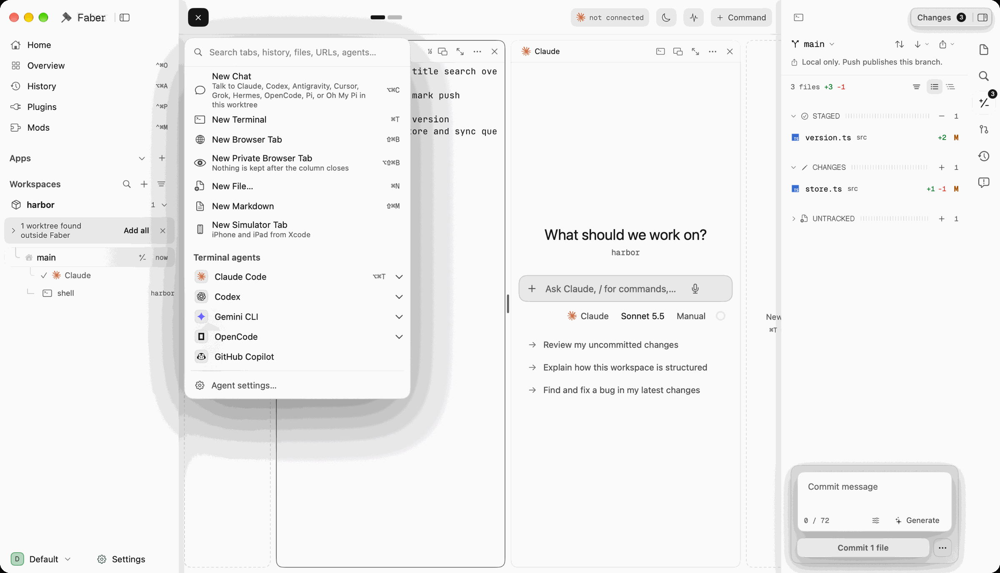

Terminals are libghostty terminals. They keep running through app updates because shells live in a separate terminal host that the app reattaches to.

## Built-in agents

Faber has 23 built-in terminal agents:

Claude Code, Codex, Gemini CLI, OpenCode, GitHub Copilot, Cursor CLI, Amp, Goose, Aider, Grok, Pi, Oh My Pi, Droid, Kimi Code, Qwen Code, Cline, Kiro, Devin, Crush, Auggie, Mistral Vibe and Antigravity and Hermes.

Nine of them also run in native [chat](chat.html) columns: Claude Code, Codex, Antigravity, Cursor CLI, Grok, Hermes, OpenCode, Pi and Oh My Pi. Other agents can be added to chat from the agent registry.

Start one from the + menu, the new worktree sheet, the [Quick Wheel](quick-composer-and-wheel.html), or `faber ... --agent`. Agents with a hook installer report their status through hooks; the rest are followed by their process, terminal title and screen.

## Custom agents

Settings, Agents, Custom agents adds your own: a name, a command (PATH name or file), default arguments, how the first prompt is passed (last argument, after a flag, typed after start, or none), environment variables (values stay in the Keychain), a starting folder and an icon.

## Launch presets

Settings, Agents, Launch presets bundle extra arguments, environment and a prompt prefix under a name. Claude Code, Codex and Gemini CLI ship a few. Pick one from the caret in the + menu or the new worktree sheet, or use `faber worktree create --agent claude --preset "Plan mode"`.

## Access

Settings, Agents, Default access (or Agent Access in a workspace's context menu) sets how far a new agent goes before asking: Ask first, Auto-edit or Full access. Claude Code, Codex, Gemini CLI and OpenCode start terminal agents with the flags of the tier you pick.

## Terminal settings

Settings, Terminal & Editor covers ligatures, cursor shape, scrollback, Option as Meta and your own ghostty config file, which loads first with Faber's values on top.
