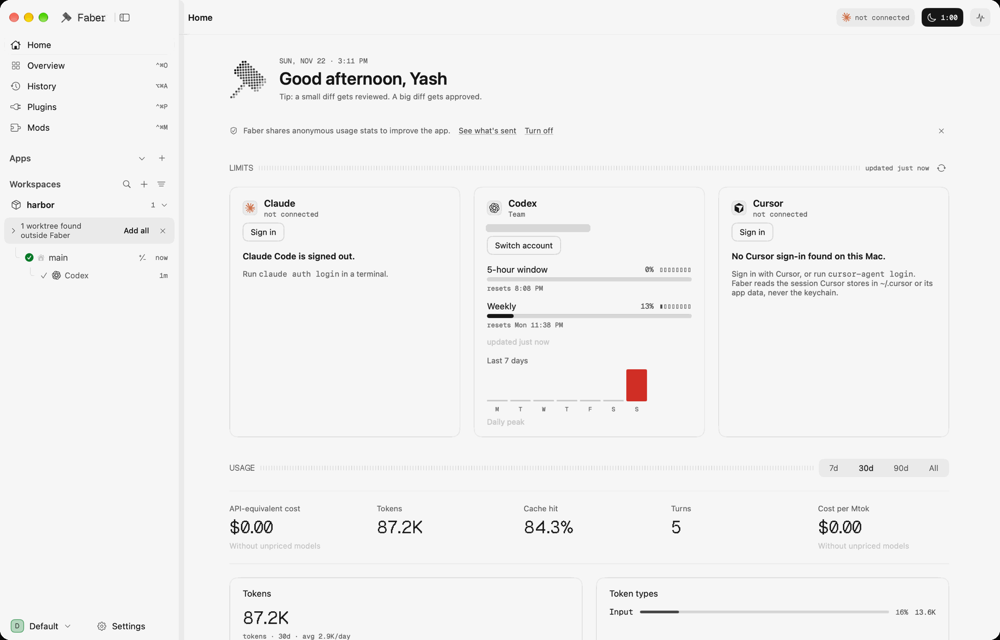
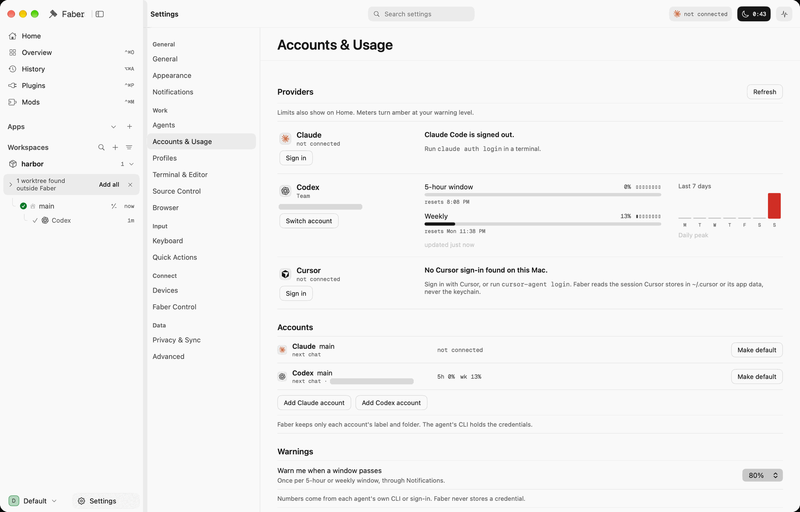

## Home

Home lists your recent repositories, ranked by when you last used one in Faber or with git. On first use it also shows a one-line notice that anonymous usage sharing is on and how to change it. You can choose what Faber opens to in Settings, General (Home, or where you left off).

## Usage

Settings, Accounts & Usage shows the Claude, Codex and Cursor limits with 5 hour and weekly windows and the active account, read from each agent's own CLI or sign-in. Faber never stores or changes an agent credential.

- Warnings: the first level is 80 percent by default (or off), and a second always comes at 95 percent. Each posts a notification once per window and tints the footer usage pill.
- Several accounts: add logins with profiles. When a chat hits a limit it can continue on another account with headroom.
- Profiles hold identity details such as git author, SSH key and agent environment, so you can switch between work and personal.

