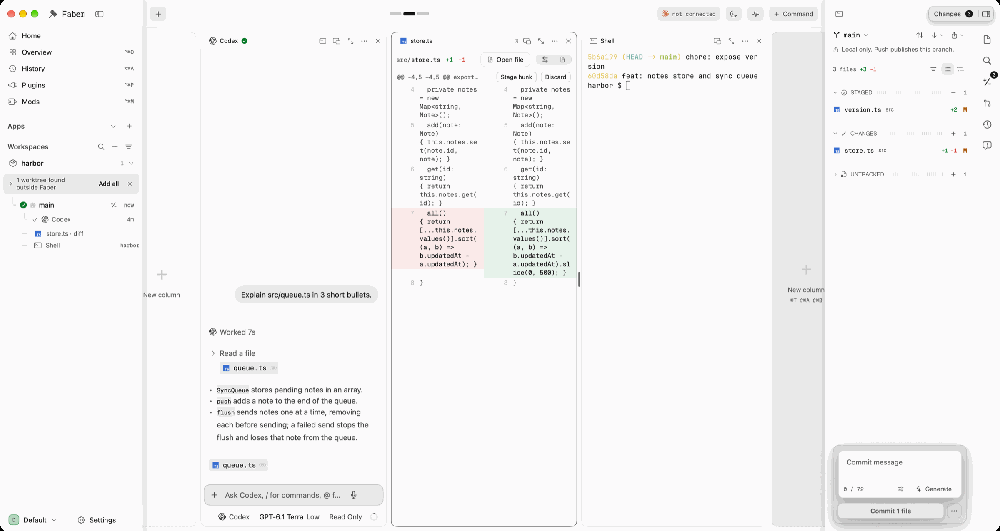

## The model

```
workspace            a repo or folder
  worktree           a git worktree, one per task
    column strip     columns side by side
      column         a tiled grid of panes
```

Panes can be terminals, agent chats, browser pages, files, diffs and Simulator tabs. The Overview page shows everything running across worktrees, with a Resources section and a Schedules section in its footer.



## Worktrees

- Settings, Source Control sets the branch prefix (default `feat/`) and where worktrees are created (default inside the repository's `.faber` folder).
- Deleting a worktree archives its branch and uncommitted files, restorable for 7, 30, 90 or 365 days (30 by default).
- Optional cleanup archives worktrees unused for 14, 30, 60 or 90 days, or after their pull request merges, and can ask before each run.
- Idle sleep ends a worktree's terminals and dev servers after it sits unused; columns stay and agents resume on wake.

## Saved layouts

Pane, Save Layout As names the current worktree's columns, splits, tab kinds and widths (private tabs are left out). Apply Layout replaces the columns after asking and keeps the old ones as closed tabs. Each saved layout is a Jump Anywhere entry.

## Closed tabs

Reopen Closed Tab and Reopen Recent keep the last 20 closed tabs across launches. Private tabs are never kept.

## Resources

The Overview's Resources section shows CPU, memory, process count and listening ports for each live terminal and agent session, with Kill Process Tree (asks first). Nothing is sampled while it is collapsed.
