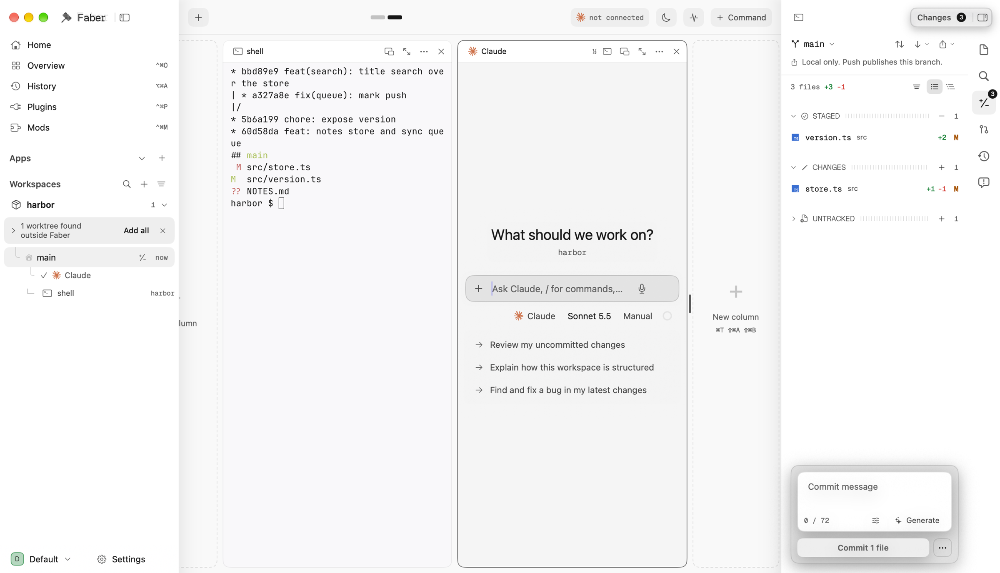

Faber runs coding agents side by side on your Mac. Each task gets its own git worktree, and each worktree is a strip of columns you fill with terminals, chats, files, diffs, browsers and more.



## Start here

- [Install and update](install-and-update.html): get the app, first run, updates.
- [Terminals and agents](features/terminals-and-agents.html): the built-in agents and how to add your own.
- [Git and pull requests](features/git-and-prs.html): review, conflicts, stacked PRs.
- [iPhone companion](phone/overview.html): approve and steer agents from your phone.
- [Mods](mods/overview.html): small add-ons that gate tool calls, add context and change the look.

## How it is laid out

```
workspace
  worktree           one per task
    strip of columns
      column         a tiled grid of panes
        pane         terminal | chat | browser | files | diff | simulator
```

## Good to know

- Native Mac app (SwiftUI and AppKit). Needs macOS 26 or later.
- Free to download and use, personal or commercial. The app source is not public; this repo hosts releases, the update feed, issues, mods, the license and the privacy policy.
- Your agents run on your Mac with your own accounts. See [privacy and telemetry](features/privacy-and-telemetry.html).
- Questions: [FAQ](faq.html), [troubleshooting](troubleshooting.html), or [open an issue](https://github.com/katipally/faber-ADE/issues/new/choose).
