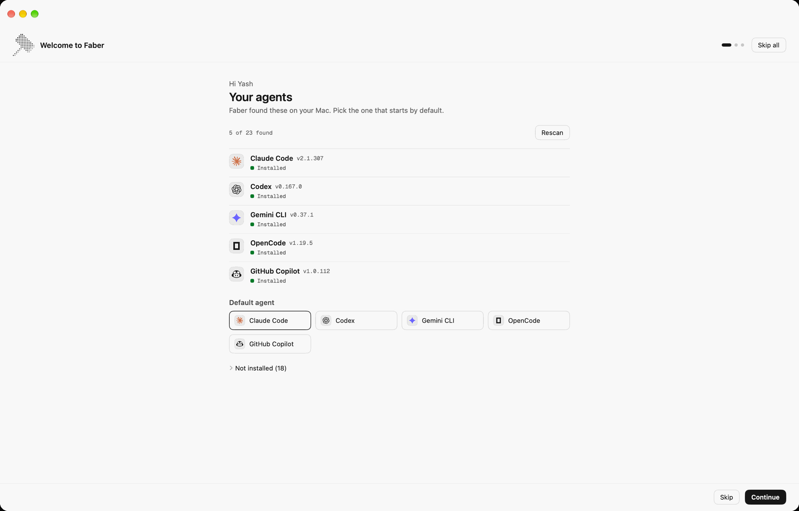

## Requirements

- macOS 26 or later. A few browser features (agent access to iframe content, Global Privacy Control) need macOS 27 and stay off on 26.
- The agent CLIs you want to use, installed on your Mac. Faber launches them; it does not bundle them.
- Xcode with an iOS runtime, only if you want the [iOS Simulator](features/simulator.html) column.

## Install

1. Open the [latest release](https://github.com/katipally/faber-ADE/releases/latest) and download the Faber zip.
2. Unzip it and drag Faber to Applications.
3. Open Faber.

## First run

A Mac with no workspace and no earlier settings opens a three-screen welcome in the main window:

1. Your agents: what is installed, install commands for the rest, and which one starts by default.
2. Tracking: one Install all button for every agent's status hooks (a sheet lists each file with its diff and backs up the originals), a Notifications Allow button, and a Keep Mac awake switch.
3. Optional iPhone pairing.

Each step can be skipped. Skip all closes the welcome. If you quit midway it resumes on the same step.

## Command line

Faber links `~/.faber/bin/faber` on launch, and terminals started inside Faber already have `faber` on their PATH. For other shells, open Settings, Faber Control and use the Link button to put it on your PATH. See [CLI and control API](features/cli-and-control-api.html).

## Updates

Faber updates itself with Sparkle.

- It checks once a day, except in Low Power Mode, and asks before installing.
- Settings, Advanced, Updates has Check for updates and a Check automatically switch.
- Updates are signed; Sparkle verifies the signature before installing.
- An update never ends a terminal. Shells keep running in the terminal host and the new app reattaches. If an update ships a newer terminal host, older shells keep working on the old one until you choose Restart Terminals to Apply Update from the menu bar menu, the Terminal menu or the status bar.
- The update feed is `appcast.xml` in this repo, and update files come from the Releases page.

## Where your data lives

Settings, workspace state, schedules and logs are in `~/.faber` on your Mac. Nothing in that folder is uploaded. To start over, Settings, Advanced, Reset Faber returns to a first launch; repositories are untouched and state is backed up first.
