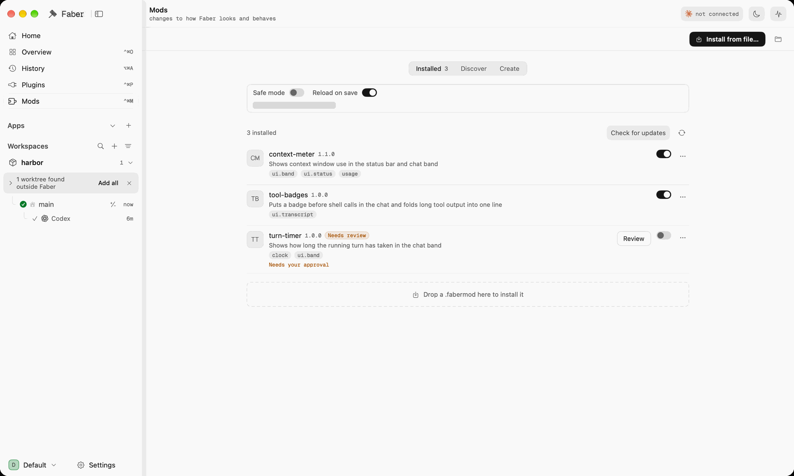

A mod is a small JavaScript add-on that changes how a Faber chat behaves: gate or rewrite tool calls, add context to prompts, show status, add panes, or restyle the look. One mod runs on every chat provider.

## What a mod can do

Depending on the capabilities it declares: hold or rewrite tool calls, add context to a turn, compose prompts, show toasts, bands, status items and panes, register slash commands and keys, read usage, or play with the look. Some can send data out or run a program, and the consent card says so.

## Safety model

- A mod runs in a sandbox, and every call it makes is checked against what you approved.
- Every mod is asked once. The consent card lists each capability in plain language.
- Consent is tied to the mod's code. Any edit asks again.
- A newly installed mod is disabled with no grant. A reload or install never grants anything.
- Agents cannot switch the gate off on their own; the Customize permission asks by default.
- Safe mode turns all mods off.

Mods in this repo are written and licensed by their authors. Faber does not review or endorse them. Read the code and the capabilities before you allow one.

Next: [installing](installing.html), [writing a mod](writing-a-mod.html), [publishing](publishing-and-marketplace.html). The [mods folder](https://github.com/katipally/faber-ADE/tree/main/mods) holds the community examples.
