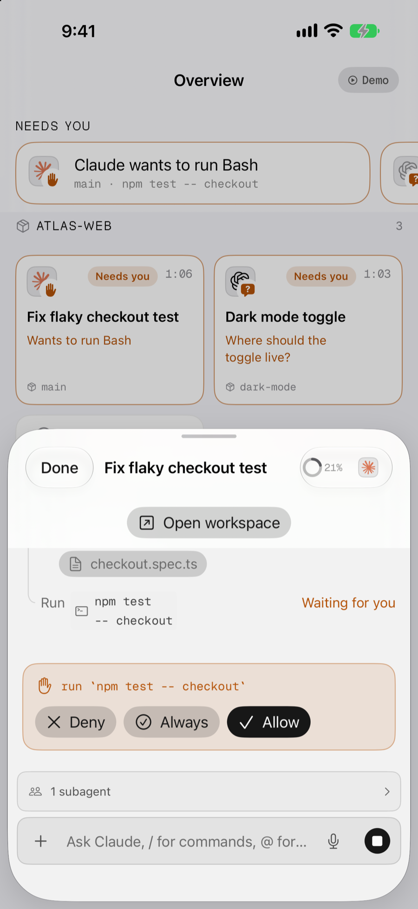

- Approvals: Allow, Deny, Always Allow or Reply, from the app or the notification.
- Chat: read and send to agent chats, with photos from the picker or camera, and dictation on the device.
- Terminals: watch and type into terminals, if you allowed terminal access.
- Changes: see a worktree's diff.
- Files: browse a worktree's folders and open files. Secrets are refused and large files capped.
- Pull requests: list, read checks and review comments, comment, approve, request changes, merge, and send failing checks to the agent. Needs `gh` or `glab` signed in on the Mac.
- Agent usage: the Claude, Codex and Cursor limits with 5 hour and weekly bars.
- Quick commands: your Quick Commands synced over iCloud.
- Alerts: a short redacted summary of what an agent needs, delivered through your private iCloud, or through Apple push if you add your own key on the Mac.
- Widgets: an Agents widget for the Home Screen and Lock Screen.
- Siri and Shortcuts: What are my agents doing, Approve pending request, Stop agent.
- Handoff: continue a session from the phone on the Mac, or the reverse.
- Demo mode with sample data.

Some features need a recent Mac build and terminal access; they are hidden on an older Mac.
