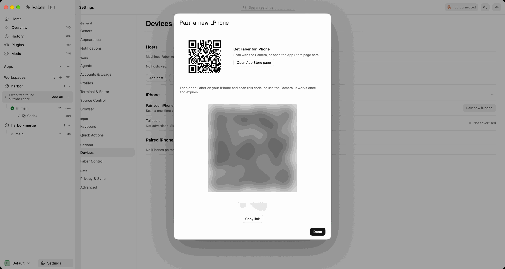

Phone access and iCloud are on by default on the Mac. Open Settings, Devices on the Mac.

## With iCloud

Open Faber Companion on the phone, signed in to the same Apple Account. Your Mac is listed under Your Macs. Tap Connect.

A phone that joins this way starts with limited access: approvals and alerts. The Mac asks whether to allow the phone to use terminals and agents. Until you allow it, the phone cannot watch or type into terminals or start them.

## With a code

1. On the Mac, press Pair new iPhone in Settings, Devices.
2. On the iPhone, scan the QR code with the Camera, or use Pair with code in the app, or paste the `faber://pair/` link.

A code works once and expires after 5 minutes. Use a code to pair a Mac on a different Apple Account.

## Several Macs

One iPhone can pair with any number of Macs. Settings, Macs switches between them, and alerts show the Mac's name once you have two or more.

## Unpair

On the phone, unpair the Mac in Settings. On the Mac, remove the iPhone in Settings, Devices.

## When it will not connect

The phone says why: Local Network is off for Faber, the iPhone is offline, the network blocks direct links, the Mac is asleep or Faber is closed, the Mac runs an older Faber, or iCloud did not answer. See [troubleshooting](../troubleshooting.html).
